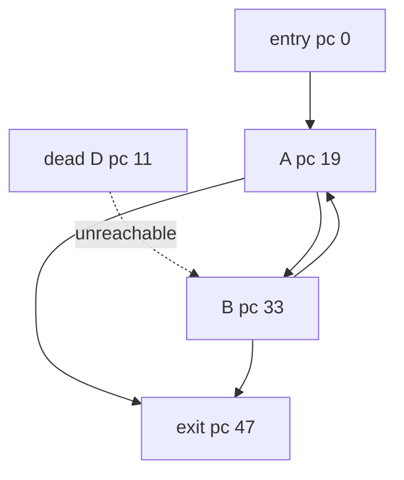

# DeadSecondaryEntry

Classification: **reachable-reducible (dead syntactic entry to B)**

A dead block supplies a syntactic secondary edge into an otherwise natural A/B loop. Every reachable cycle consumes budget, and all control-flow edges cross stack-empty block boundaries.

## Control-flow graph



## Exact blocks

- `entry`: pc 0
- `toA`: pc 8
- `dead`: pc 11
- `A`: pc 19
- `AtoB`: pc 30
- `B`: pc 33
- `BtoA`: pc 44
- `exit`: pc 47

## Typed edges

- `entry -> exit` (ifle/taken)
- `entry -> toA` (ifle/fallthrough)
- `toA -> A` (goto)
- `dead -> B` (goto/unreachable)
- `A -> exit` (ifle/taken)
- `A -> AtoB` (ifle/fallthrough)
- `AtoB -> B` (goto)
- `B -> exit` (ifle/taken)
- `B -> BtoA` (ifle/fallthrough)
- `BtoA -> A` (goto/backedge)

Cyclic SCC: `A, AtoB, B, BtoA`

SCC entry targets: `A`

## Symbolic bytecode

```text
entry: x=budget; acc=entry; if x<=0 goto exit; goto A
dead D: acc+=99; goto B
A: acc+=2; x--; if x<=0 goto exit; goto B
B: acc+=3; x--; if x<=0 goto exit; goto A
exit: return acc
```
