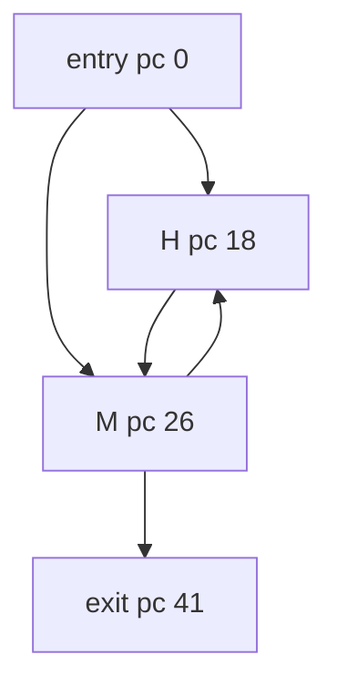

# IrreducibleMidBodyPhi

Classification: **irreducible**

A secondary entry reaches the loop body at a local-value merge. Every reachable cycle consumes budget, and all control-flow edges cross stack-empty block boundaries.

## Control-flow graph



## Exact blocks

- `entry`: pc 0
- `select`: pc 11
- `toM`: pc 15
- `H`: pc 18
- `M`: pc 26
- `MtoH`: pc 38
- `exit`: pc 41

## Typed edges

- `entry -> exit` (ifle/taken)
- `entry -> select` (ifle/fallthrough)
- `select -> H` (ifeq/taken)
- `select -> toM` (ifeq/fallthrough)
- `toM -> M` (goto/entry)
- `H -> M` (goto)
- `M -> exit` (ifle/taken)
- `M -> MtoH` (ifle/fallthrough)
- `MtoH -> H` (goto/backedge)

Cyclic SCC: `H, M, MtoH`

SCC entry targets: `H, M`

## Symbolic bytecode

```text
entry: x=budget; acc=entry; value=entry; if entry==0 goto H else M
H: value=acc+2; goto M
M: acc+=value; x--; if x<=0 exit; goto H
exit: return acc
```
