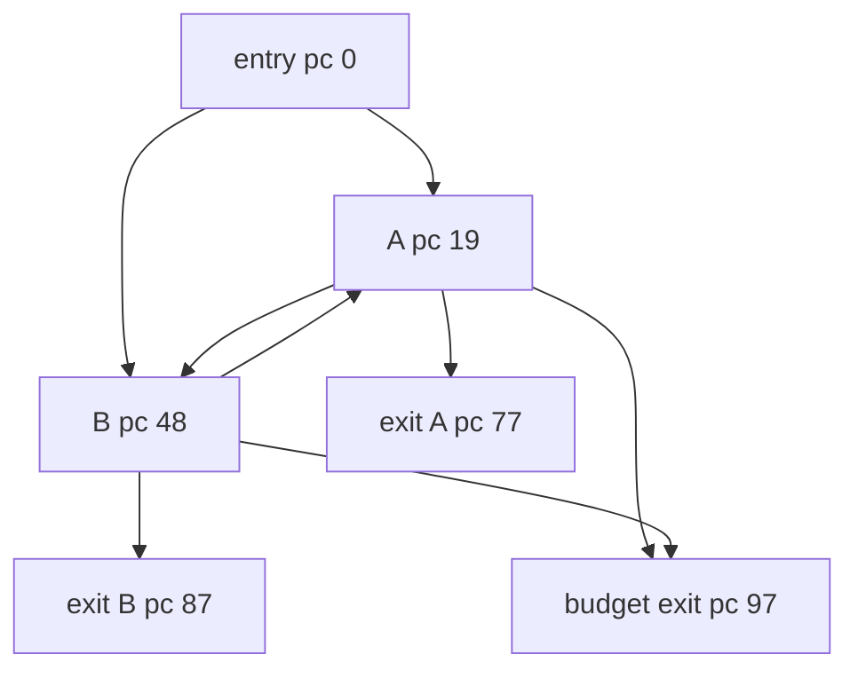

# IrreducibleMultiExitEffects

Classification: **irreducible**

A two-entry cycle has distinct effectful early exits and a budget exit. Every reachable cycle consumes budget, and all control-flow edges cross stack-empty block boundaries.

## Control-flow graph



## Exact blocks

- `entry`: pc 0
- `select`: pc 12
- `toB`: pc 16
- `A`: pc 19
- `Atest`: pc 38
- `AtoB`: pc 45
- `B`: pc 48
- `Btest`: pc 68
- `BtoA`: pc 74
- `exitA`: pc 77
- `exitB`: pc 87
- `budgetExit`: pc 97

## Typed edges

- `entry -> budgetExit` (ifle/taken)
- `entry -> select` (ifle/fallthrough)
- `select -> A` (ifeq/taken)
- `select -> toB` (ifeq/fallthrough)
- `toB -> B` (goto/entry)
- `A -> budgetExit` (ifle/taken)
- `A -> Atest` (ifle/fallthrough)
- `Atest -> exitA` (ifeq/taken)
- `Atest -> AtoB` (ifeq/fallthrough)
- `AtoB -> B` (goto)
- `B -> budgetExit` (ifle/taken)
- `B -> Btest` (ifle/fallthrough)
- `Btest -> exitB` (ifeq/taken)
- `Btest -> BtoA` (ifeq/fallthrough)
- `BtoA -> A` (goto/backedge)

Cyclic SCC: `A, Atest, AtoB, B, Btest, BtoA`

SCC entry targets: `A, B`

## Symbolic bytecode

```text
entry: effects=0; x=budget; acc=entry; choose A/B
A: effects+=1; acc+=2; x--; budget/early exit or B
B: effects+=10; acc+=3; x--; budget/early exit or A
exitA/exitB/budgetExit: return acc plus selected effects
```
