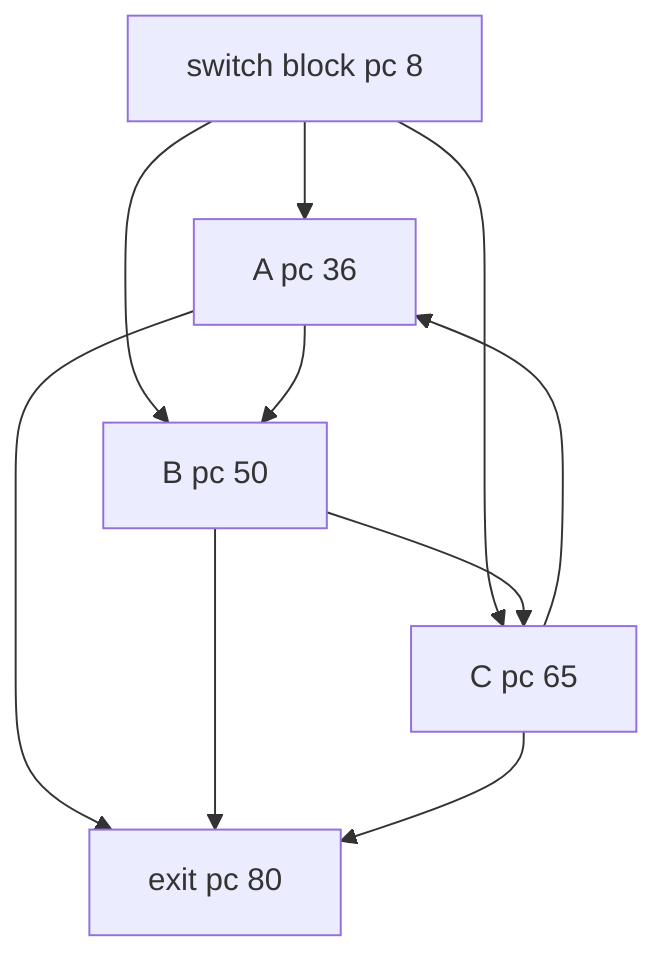

# IrreducibleSwitchThreeEntry

Classification: **irreducible**

A tableswitch enters each node of a three-node cycle. Every reachable cycle consumes budget, and all control-flow edges cross stack-empty block boundaries.

## Control-flow graph



## Exact blocks

- `entry`: pc 0
- `switch`: pc 8
- `A`: pc 36
- `AtoB`: pc 47
- `B`: pc 50
- `BtoC`: pc 62
- `C`: pc 65
- `CtoA`: pc 77
- `exit`: pc 80

## Typed edges

- `entry -> exit` (ifle/taken)
- `entry -> switch` (ifle/fallthrough)
- `switch -> A` (tableswitch case 0/default)
- `switch -> B` (tableswitch case 1)
- `switch -> C` (tableswitch case 2)
- `A -> exit` (ifle/taken)
- `A -> AtoB` (ifle/fallthrough)
- `AtoB -> B` (goto)
- `B -> exit` (ifle/taken)
- `B -> BtoC` (ifle/fallthrough)
- `BtoC -> C` (goto)
- `C -> exit` (ifle/taken)
- `C -> CtoA` (ifle/fallthrough)
- `CtoA -> A` (goto/backedge)

Cyclic SCC: `A, AtoB, B, BtoC, C, CtoA`

SCC entry targets: `A, B, C`

## Symbolic bytecode

```text
entry: x=budget; acc=entry; tableswitch entry {0:A,1:B,2:C,default:A}
A: acc+=1; x--; if x<=0 exit; goto B
B: acc+=10; x--; if x<=0 exit; goto C
C: acc+=100; x--; if x<=0 exit; goto A
exit: return acc
```
