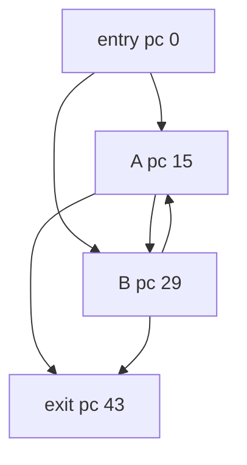

# IrreducibleTwoEntry

Classification: **irreducible**

A two-node strongly connected component entered independently at both nodes. Every reachable cycle consumes budget, and all control-flow edges cross stack-empty block boundaries.

## Control-flow graph



## Exact blocks

- `entry`: pc 0
- `select`: pc 8
- `toB`: pc 12
- `A`: pc 15
- `AtoB`: pc 26
- `B`: pc 29
- `BtoA`: pc 40
- `exit`: pc 43

## Typed edges

- `entry -> exit` (ifle/taken)
- `entry -> select` (ifle/fallthrough)
- `select -> A` (ifeq/taken)
- `select -> toB` (ifeq/fallthrough)
- `toB -> B` (goto/entry)
- `A -> exit` (ifle/taken)
- `A -> AtoB` (ifle/fallthrough)
- `AtoB -> B` (goto)
- `B -> exit` (ifle/taken)
- `B -> BtoA` (ifle/fallthrough)
- `BtoA -> A` (goto/backedge)

Cyclic SCC: `A, AtoB, B, BtoA`

SCC entry targets: `A, B`

## Symbolic bytecode

```text
entry: x=budget; acc=entry; if x<=0 exit; if entry==0 goto A else B
A: acc+=3; x--; if x<=0 exit; goto B
B: acc+=5; x--; if x<=0 exit; goto A
exit: return acc
```
