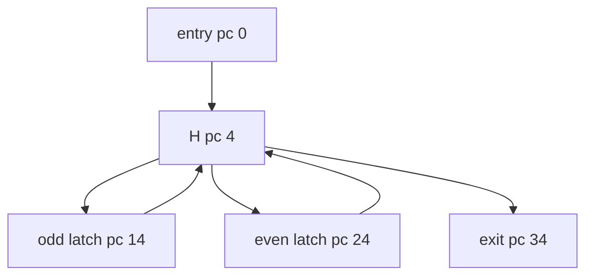

# NaturalMultipleLatch

Classification: **reducible**

One natural loop with two distinct latch blocks. Every reachable cycle consumes budget, and all control-flow edges cross stack-empty block boundaries.

## Control-flow graph



## Exact blocks

- `entry`: pc 0
- `H`: pc 4
- `dispatch`: pc 8
- `oddLatch`: pc 14
- `evenLatch`: pc 24
- `exit`: pc 34

## Typed edges

- `entry -> H` (fallthrough)
- `H -> exit` (ifle/taken)
- `H -> dispatch` (ifle/fallthrough)
- `dispatch -> evenLatch` (ifeq/taken)
- `dispatch -> oddLatch` (ifeq/fallthrough)
- `oddLatch -> H` (goto/backedge)
- `evenLatch -> H` (goto/backedge)

Cyclic SCC: `H, dispatch, oddLatch, evenLatch`

SCC entry targets: `H`

## Symbolic bytecode

```text
entry: x=budget; acc=entry
H: if x<=0 goto exit; if (x&1)==0 goto even
odd: acc+=3; x--; goto H
even: acc+=2; x--; goto H
exit: return acc
```
