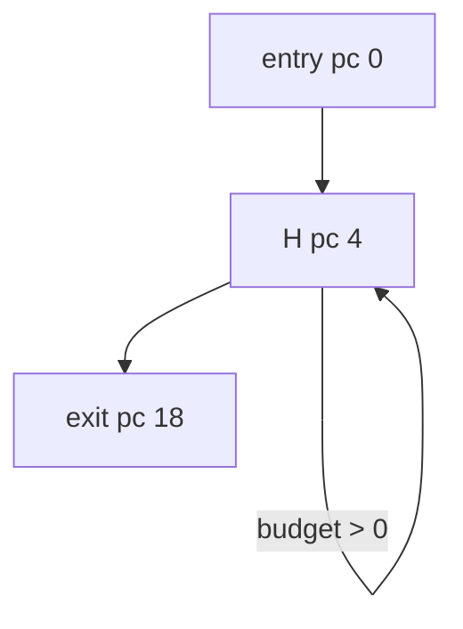

# NaturalSingleEntry

Classification: **reducible**

One natural loop with one header and one latch. Every reachable cycle consumes budget, and all control-flow edges cross stack-empty block boundaries.

## Control-flow graph



## Exact blocks

- `entry`: pc 0
- `H`: pc 4
- `body`: pc 8
- `exit`: pc 18

## Typed edges

- `entry -> H` (fallthrough)
- `H -> exit` (ifle/taken)
- `H -> body` (ifle/fallthrough)
- `body -> H` (goto/backedge)

Cyclic SCC: `H, body`

SCC entry targets: `H`

## Symbolic bytecode

```text
entry: x=budget; acc=entry
H: if x<=0 goto exit; acc+=x; x--; goto H
exit: return acc
```
