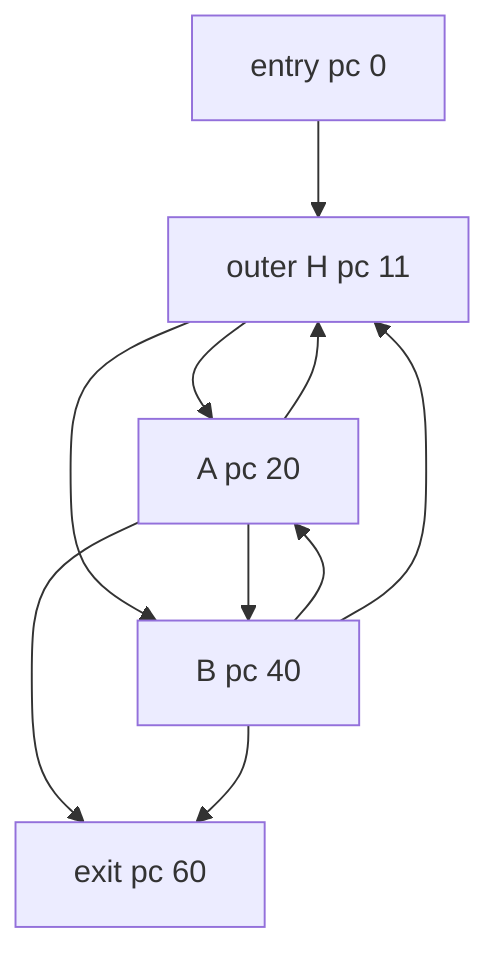

# RegionalIrreducibility

Classification: **regionally-irreducible (whole SCC has outer header H; cyclic subregion A/B has entry targets A and B)**

A natural outer loop contains an A/B subregion with two entries. Every reachable cycle consumes budget, and all control-flow edges cross stack-empty block boundaries.

## Control-flow graph



## Exact blocks

- `entry`: pc 0
- `toH`: pc 8
- `H`: pc 11
- `HtoB`: pc 17
- `A`: pc 20
- `Adispatch`: pc 31
- `AtoB`: pc 37
- `B`: pc 40
- `Bdispatch`: pc 51
- `BtoH`: pc 57
- `exit`: pc 60

## Typed edges

- `entry -> exit` (ifle/taken)
- `entry -> toH` (ifle/fallthrough)
- `toH -> H` (goto)
- `H -> A` (ifeq/taken)
- `H -> HtoB` (ifeq/fallthrough)
- `HtoB -> B` (goto)
- `A -> exit` (ifle/taken)
- `A -> Adispatch` (ifle/fallthrough)
- `Adispatch -> H` (ifeq/taken)
- `Adispatch -> AtoB` (ifeq/fallthrough)
- `AtoB -> B` (goto)
- `B -> exit` (ifle/taken)
- `B -> Bdispatch` (ifle/fallthrough)
- `Bdispatch -> A` (ifeq/taken)
- `Bdispatch -> BtoH` (ifeq/fallthrough)
- `BtoH -> H` (goto/backedge)

Cyclic SCC: `H, HtoB, A, Adispatch, AtoB, B, Bdispatch, BtoH`

SCC entry targets: `H`

## Symbolic bytecode

```text
entry: x=budget; acc=entry; goto H
H: choose A/B by acc parity
A: acc+=2; x--; exit, H, or B
B: acc+=5; x--; exit, A, or H
exit: return acc
```
